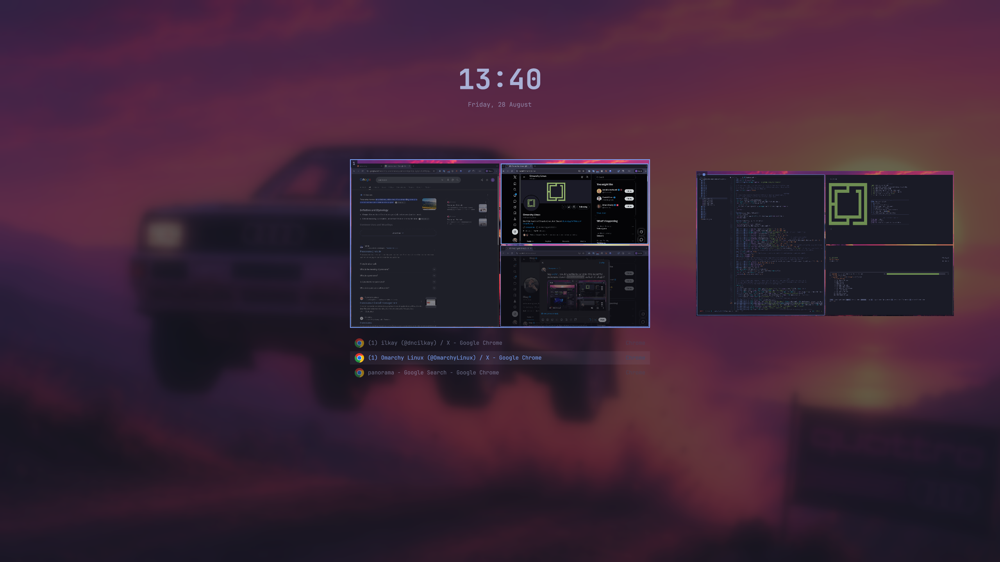
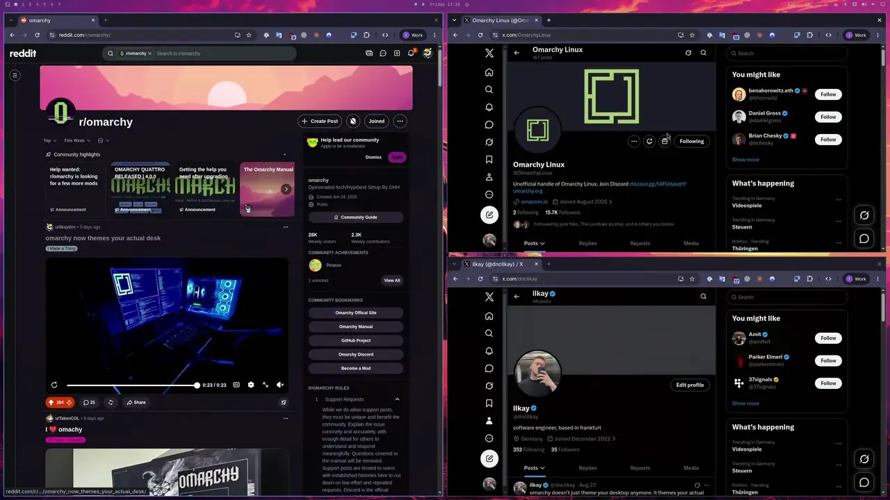

# Panorama

Every workspace in one wide view.

Double-tap Super and the screen you are on pulls back into a strip of live
workspace feeds. Real window captures over your wallpaper, not icons. The
workspace you were on sits in the centre, its windows listed beneath it as rows
of app icon and title. Walk the strip, pick a window, press Enter, and it zooms
back in on a frame identical to the desktop underneath. A community plugin for
Omarchy 4, not part of Omarchy itself.



The whole gesture in eleven seconds. Pull back, walk the strip, cut in:



The full minute, across three themes, is attached to the
[latest release](https://github.com/ilkaydnc/omarchy-panorama/releases/latest).

Panorama looks, and it picks. It moves no windows between workspaces and closes
nothing. I built the drag-and-drop once and took it back out, because a viewer
that also rearranges your desk is a worse viewer.

It has no look of its own either. Out of the box it borrows the shell's picker
tokens. The `[image-picker]` scrim goes over your wallpaper, blurred the way the
lock screen blurs it. The picker's borders go on the feeds, the `[menu]`
selected fill on the cursor row, your theme's radius on the corners, and app
icons come from your icon theme through the launcher's own lookup. A theme that
wants more can dress it. See [theming](#theming).

## Requirements

- Omarchy 4 (the Quattro shell). This is a shell plugin, not a standalone app.
- Hyprland, which Omarchy already runs. The feeds are wlroots screencopy
  captures, so windows on hidden workspaces show real pixels, live. Omarchy 4
  configures Hyprland in Lua, and that is how Panorama registers its own key. On
  a legacy `hyprland.conf` setup it registers nothing and you add the bind
  yourself.
- Nothing else. No daemon, no package, no network. Panorama writes no files at
  all. It reads its settings from its own entry in `shell.json` and asks
  `hyprctl` what your workspaces look like.

## Install

```bash
omarchy plugin add https://github.com/ilkaydnc/omarchy-panorama.git --enable
```

That is the whole install. Panorama claims its own key as it loads, a
double-tap of Super, and nothing under `~/.config/hypr` is read or written to do
it. The bind is registered in the running session through `hyprctl eval`, the
same `hl.bind` call Omarchy's own bind helper makes.

Two taps inside `doubleTap` ms, 300 by default, open it. A single tap does
nothing at all. Any tap while it is open closes it. Hyprland shadows a release
bind on Super after a `SUPER+key` combo, so your ordinary shortcuts never trip
it.

A key that is already bound wins. Panorama looks first and takes nothing if
something is there, yours or anyone else's, so the line you added by hand keeps
working and you stay the one who decides. Two dispatchers on one tap would count
every tap twice and open on a single one.

For another key, set `bind` (see [settings](#settings)). A bare modifier gets a
release bind and the double-tap detector. Anything else is an ordinary press
that toggles, and note that `SUPER+TAB` is already Omarchy's next-workspace:

```json
{ "id": "io.github.ilkaydnc.panorama", "bind": "SUPER + GRAVE" }
```

`"bind": false` claims nothing, if you would rather keep every bind in one file:

```lua
o.bind("SUPER + SUPER_L", "Panorama", "omarchy-shell panorama tap", { release = true })
```

Because the bind is a runtime one, `hyprctl binds` and `omarchy menu
keybindings` list it under the dispatcher `__lua`, described as Panorama.

## Keys

| Key | What it does |
| --- | --- |
| `←` `→`, wheel | Move along the strip. Always. These never mean anything else. |
| `↑` `↓` | Walk the window rows under the selected feed. `↑` past the first steps back out to the feed. |
| `Home` `End` | Jump to the ends of the strip. |
| `1`–`9` | Cut straight to that workspace. |
| `/` | Open search. A letter on its own does nothing, so a stray key cannot startle you. |
| `Tab` `Shift+Tab` | Step through the matches. |
| `Backspace` | Edit the query. On the last character, leave search. |
| `Enter` | Cut into the chosen window or workspace. |
| `Escape` | Leave search. Press it again to leave Panorama, flying back to the workspace actually on screen. |

The pointer peeks. Point at a window inside the selected feed, or at its row,
and the ring and the cursor follow you. The keys never change meaning under the
pointer, and only a keyboard or query pick makes the rest of the workspace step
back. Click commits.

Search is a place you go, not a mode you fall into. While it is open the query
takes the date's line under the clock, at the date's size, and the clock never
moves or leaves. Workspaces holding no match fall back, rows that miss fade,
and the matches carry the accent inside their titles.

The strip includes an empty numbered destination when `maximum` leaves room.
Arriving there creates nothing. Hyprland makes it real when you cut into it,
the same way `SUPER+1..9` does.

Named workspaces appear first in creation order, including empty persistent
workspaces, and count toward `minimum` and `maximum`. Numbered slots fill the
remaining room, always in ascending order, and end on an empty destination
only when the cap leaves room for one. Real named workspaces,
occupied numbered workspaces, and each monitor's active workspace stay visible
even beyond `maximum`. Names appear on feeds and receipts. Digit keys still
select numbered workspace IDs.

## The zoom

Open zooms out. The overlay appears as a 1:1 copy of the screen, the live feed
of the current workspace at full size, and shrinks into the focus slot while the
chrome fades in. Enter zooms in. The chosen feed grows back to the full screen,
Panorama tells Hyprland to switch underneath, and the overlay disappears on a
frame that matches the real desktop. Every frame recomputes the mapping from the
selected feed as drawn, mid-pan and mid-scale, so interrupting a pan with Enter
still lands exactly.

All of it runs on the compositor's frame callbacks, snapped to the monitor's
frame period. A 240 Hz panel gets 240 distinct steps a second, and 340 ms means
340 ms. Nothing animates while Panorama is closed. No timer, no tick, no
repaint.

## The bar

The bar goes with the desktop. Hiding the real bar would drop its exclusive
zone and re-tile every window under the copy, so Panorama never hides it. A
second monitor-wide surface lies over the bar's strip and fades in the same
blurred wallpaper and scrim as the copy shrinks, then out again as it grows.
Both surfaces map one field between them, so they join without a seam. Set
`bar` to `shown` to keep the bar visible instead.

## Settings

Settings live on Panorama's own entry in `~/.config/omarchy/shell.json`. There
is no separate config file:

```json
{
  "plugins": [
    {
      "id": "io.github.ilkaydnc.panorama",
      "zoom": 340,
      "feed": 30,
      "thumbnails": "live"
    }
  ]
}
```

| Key | Default | Range | What |
| --- | --- | --- | --- |
| `bind` | `"SUPER + SUPER_L"` | a key spec, or `false` | The key Panorama claims as it loads. A key already bound wins. `false` claims none. |
| `zoom` | `340` | 0–800 ms | Length of the zoom. `0` cuts. |
| `zoomEase` | `[0.45, 0, 0.15, 1]` | four numbers | Cubic-bezier of the zoom. |
| `feed` | `30` | 18–45 | Width of the selected feed, as a percent of the screen. |
| `pan` | `200` | 0–600 ms | Time the strip takes to slide one workspace. |
| `card` | `0` | 0–400 ms | How long a receipt of what you chose is held after the zoom. `0` is none. |
| `thumbnails` | `live` | `live`, `static`, `off` | Live captures, one frame each, or none. |
| `minimum` | `5` | 1–10 | Fewest workspaces the strip shows. |
| `maximum` | `10` | 1–20 | Most it shows. The trailing empty slot lives inside this cap. |
| `icons` | `8` | 1–12 | Window rows visible at once. |
| `rows` | `4` | 1–8 | Rows listed by the `record` dress. |
| `doubleTap` | `300` | 100–1000 ms | Window for the double-tap of Super. |
| `field` | `1` | 0–3 | Density of the stills field, when a theme provides one. `0` is off. |
| `bar` | `hidden` | `hidden`, `shown` | Whether the veil covers the bar while open. |

## Theming

A theme may dress Panorama with an optional `[panorama]` section in its
`shell.toml`. Every key is optional. Colours take either a role name
(`background`, `foreground`, `accent`, `muted`) or a hex value.

| Key | Default | What |
| --- | --- | --- |
| `backdrop`, `backdrop-alpha` | image-picker scrim, a shade deeper | The scrim over the field. |
| `field` | `wallpaper` | `wallpaper`, `stills`, or `off`. |
| `field-blur` | `0.8` | 0–1. `0` leaves the wallpaper sharp. |
| `field-density` | `1` | 0–3, for the stills field. |
| `frame`, `frame-alpha` | image-picker unselected border | Feed frames and hairlines. |
| `frame-style` | `line` | `line` puts focus on the feed's own border. `brackets` grips the slot with corner brackets. `none` draws no focus frame. |
| `list` | `dock` | `dock` lifts icon and title rows in out of the feed. `record` prints a typed list on hairlines. |
| `glass` | `false` | A thick band of smoked glass around every feed, blurring the field behind it. |
| `wires` | `false` | Hairlines: strip links, stems down to the list, capture outlines, rules. |
| `focus` | image-picker selected border | Focus border, chosen window, match highlights. |
| `text`, `muted` | image-picker text | Primary and secondary text. |
| `readout`, `readouts` | `muted`, `false` | Colour of system values. `readouts` adds counts, seconds, the screen, and a frame / refresh / zoom / capture line. |
| `case` | `normal` | `upper` or `normal` labels. |
| `numbers` | `plain` | `padded` writes 03, `plain` writes 3. |
| `stills-path` | `<current theme>/panorama` | Where the stills atlases live. |

The stills field is the one dress that needs assets. It wants `field-4.png`,
`field-12.png`, `field-24.png` and `field-48.png`, one atlas per depth, sixteen
square frames in a row. Hundreds of tiles then float in depth behind the strip,
flowing outward from the focus frame at four parallax rates, all on the GPU with
no per-frame work on the CPU. Without the atlases the field stays off.

## IPC

```
omarchy-shell panorama toggle
omarchy-shell panorama open
omarchy-shell panorama close
omarchy-shell panorama openWith "<query>"
omarchy-shell panorama enter
omarchy-shell panorama tap
omarchy-shell panorama state
```

`enter` commits whatever is selected. `state` prints `open` or `closed`.

## Uninstall

```bash
omarchy plugin remove io.github.ilkaydnc.panorama
```

That deletes the plugin folder and its own entry in
`~/.config/omarchy/shell.json`, the only place outside the folder that knows
about it. The key goes too: the bind lives in the session, and Panorama drops it
as the plugin unloads. If you bound a key by hand, that line is yours to take
out.

## How it works

Worth knowing if you hack on it, and the reason a few things look odd in the
source.

**The surface is never unmapped and never resized.** Hyprland fades layer
surfaces in and out on map and unmap, and tweens a mapped surface through a
geometry change. Either one would blend or squeeze a copy that is supposed to be
exact. So the overlay is always the full desktop area. Idle it is fully
transparent, input-masked and on the Bottom layer, which never blocks direct
scanout. Open, it switches to the Overlay layer, and a layer change alone warps.

**Keyboard focus goes before the dispatch.** Hyprland refuses to focus a window
while a layer surface holds exclusive keyboard focus, so Enter drops focus first
and the switch follows a beat later, 24 ms.

**Nothing the compositor reports gets acted on mid-commit.** A refresh landing
inside the zoom would rebuild the very feed being blown up and restart the
captures inside it.

**Nothing under `~/.config/hypr` is touched.** Hyprland 0.56 parses binds with
its Lua provider, which refuses `hyprctl keyword bind` outright, so the key goes
in through `hyprctl eval`. What comes out of `shell.json` is checked against key
names and pluses before it reaches a Lua interpreter. A session bind dies on a
config reload, which is why the reload event puts it back, and it dies with the
plugin, which is why removing Panorama leaves no key behind.

**The version directory is deliberate.** The shell caches compiled QML
components per process, so a release ships as a new `<version>/` folder with the
manifest pointing at it. That is what makes `omarchy plugin update` take effect
without restarting your shell.

## Limits

Built and used on a single 2560×1440 monitor at scale 1. On more than one
monitor it opens on the focused one, which is the intent, but I have no second
monitor to prove it. Fractional scaling is untested for the same reason. Reports
welcome.

## Tests

Run `node --test` from the repository root with Node.js 20 or newer. The tests
execute methods and label bindings extracted from `Panorama.qml`, with shell,
monitor, and timer dependencies stubbed. No packages or display server are
needed. If `lua` is installed (or `LUA` names an interpreter), an additional
test evaluates the generated focus command to check that workspace names
survive Lua string parsing; without one it is skipped. This does not
verify rendered captures or live Hyprland focus changes.

## License

MIT. See [LICENSE](LICENSE).
